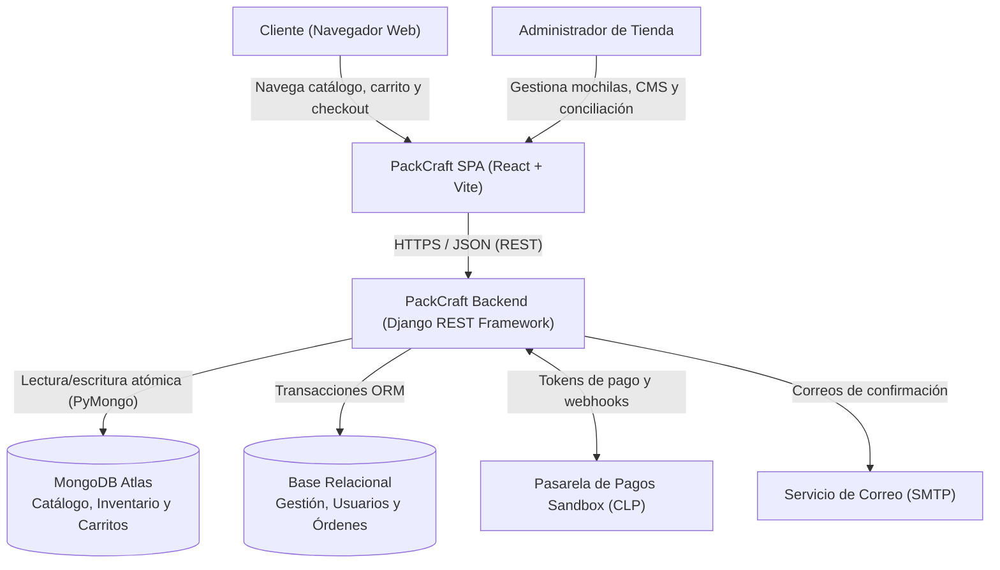
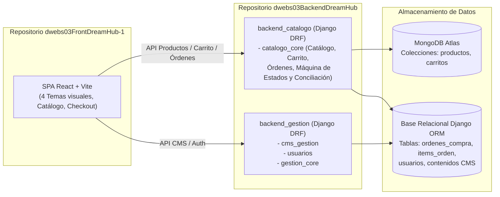

# dwebs03BackendDreamHub# PackCraft (DreamHub) — Backend de Comercio Electrónico de Mochilas

Plataforma backend para la tienda de comercio electrónico **PackCraft**, especializada en mochilas técnicas, urbanas, outdoor y de viaje, con precios y transacciones expresadas en **Pesos Chilenos (CLP)**.

---

## 1. Especificación del Rubro y Alcance

* **Rubro aprobado:** Mochilas técnicas, urbanas, outdoor y de viaje.
* **Moneda oficial:** CLP (enteros positivos estrictamente mayores a 0).
* **Atributos técnicos de producto:** `sku` inmutable, `capacidad_litros`, `badge`, `categoria_id`, `precio`, `stock_inicial`, `stock_reservado`, galería obligatoria de 4 a 6 URLs de imágenes y bandera `estado_activo`.
* **Repositorio Frontend (SPA):** `dwebs03FrontDreamHub-1` (React + Vite + Tailwind CSS).

---

## 2. Equipo y Responsabilidades

| Integrante | Rol | Responsabilidad Principal |
| :--- | :--- | :--- |
| **Kamila** | Frontend Lead | React, Vite, Tailwind CSS, accesibilidad WCAG, vistas responsivas y consumo de API. |
| **Sergio** | Backend Lead — Catálogo e Inventario | Django REST Framework, MongoDB Atlas (PyMongo), validación BSON y control de existencias. |
| **Gabriel** | Backend Lead — Gestión | Django REST Framework, CMS dinámico, usuarios, RBAC y notificaciones de correo. |
| **José (JP)** | Scrum Master & Backend Lead — Comercio | Lógica de carrito/fusión, snapshot inmutable de órdenes, máquina de estados, conciliación RF-38 y coordinación Scrum. |
| **Nicolás** | DevOps, QA & Performance Engineer | Pruebas de carga Locust, concurrencia, idempotencia de webhooks y aseguramiento de calidad. |
| **Emerson** | Fullstack Integration Engineer | Integración API, formularios administrativos, pasarela de pagos Sandbox en CLP y webhooks. |

---

## 3. Arquitectura y Diagramas C4

### 3.1 Nivel 1 — Diagrama de Contexto



### 3.2 Nivel 2 — Diagrama de Contenedores (Estructura Actual del Repositorio)



> **Nota arquitectónica:** Los módulos transaccionales de carrito, órdenes, máquina de estados y conciliación residen actualmente dentro de `backend_catalogo/catalogo_core` mientras el servicio se consolida. Antes del congelamiento definitivo (`v1.0.0-final`), el motor `DATABASES['default']` en `backend_catalogo/catalogo_core/settings.py` (actualmente en SQLite para desarrollo local) debe apuntar a la instancia de PostgreSQL con segregación de esquemas.

---

## 4. Estructura del Repositorio

```text
dwebs03BackendDreamHub/
├── backend_catalogo/
│   ├── catalogo_core/
│   │   ├── db_mongo.py                 # Conexión PyMongo y validador BSON estricto (4-6 fotos)
│   │   ├── models.py                   # OrdenDeCompra (7 estados), ItemOrden (snapshot inmutable)
│   │   ├── reconciliation.py           # Conciliación RF-38 con transacción atómica y reversión
│   │   ├── serializers.py              # ProductoSerializer e ItemCarritoSerializer
│   │   ├── urls.py                     # Enrutador REST de catálogo, carrito y órdenes
│   │   ├── views.py                    # Vistas DRF (paginación, CRUD, carrito, checkout, estados)
│   │   ├── tests.py                    # Suite de máquina de estados y pagos tardíos
│   │   └── test_cobertura_comercio.py  # Suite de cobertura integral (carrito, órdenes, RBAC)
│   ├── locustfile.py                   # Pruebas de carga de catálogo (RNF-02)
│   ├── generar_productos_test.py       # Utilidad de carga de datos de prueba
│   ├── pytest.ini                      # Configuración de pytest-django
│   └── manage.py
├── backend_gestion/
│   ├── cms_gestion/                    # Contenidos editables, temas y notificaciones de correo
│   ├── gestion_core/                   # Configuración núcleo de Django Gestión
│   ├── usuarios/                       # Gestión de cuentas y roles
│   ├── manage.py
│   └── requirements.txt
├── .gitignore
└── README.md
```

---

## 5. Endpoints Principales (`backend_catalogo`)

| Método | Ruta | Descripción | Requerimiento |
| :--- | :--- | :--- | :--- |
| `GET` | `/api/health/` | Verificación de salud del servicio y ping a MongoDB Atlas. | Infraestructura |
| `GET` | `/api/products/?page=1&limit=10` | Catálogo público paginado de mochilas activas (límite máximo estricto: 50). | RF-20, RNF-03 |
| `GET` | `/api/products/<producto_id>/` | Detalle de mochila por `ObjectId` o `sku`. | RF-21 |
| `POST` | `/api/admin/productos/crear/` | Creación administrativa de mochilas (`IsAdminUser`, 4–6 imágenes, precio > 0). | RF-16, RB-03, RB-05 |
| `POST` | `/carrito/sincronizar/` | Fusión de carrito anónimo/autenticado y recálculo de totales en backend. | RF-22 a RF-26, CC-06 |
| `POST` | `/ordenes/crear/` | Generación de orden en `PENDIENTE_PAGO` con snapshot de precios inmutable. | RF-27, RF-28, RB-08 |
| `GET` | `/ordenes/revision-requerida/` | Listado de órdenes derivadas a revisión manual por pago tardío o discrepancia. | RF-38 |
| `POST` | `/ordenes/<uuid:orden_id>/estado/` | Transición controlada sobre la máquina de 7 estados (`HTTP 409` en saltos inválidos). | Sección 5 |
| `POST` | `/ordenes/<uuid:orden_id>/conciliar-pago/` | Conciliación idempotente de pago y prevención de stock negativo en pagos tardíos. | RF-33, RF-38, RNF-09 |

---

## 6. Guía de Instalación desde Clon Limpio

### Requisitos previos
* Python 3.12 o superior.
* Acceso a un clúster Replica Set de MongoDB Atlas (necesario para transacciones multidocumento).
* PostgreSQL (para despliegue productivo de esquemas relacionales).

### 6.1 Clonar el repositorio y crear entorno virtual

```bash
git clone [https://github.com/ReneGG/dwebs03BackendDreamHub.git](https://github.com/ReneGG/dwebs03BackendDreamHub.git)
cd dwebs03BackendDreamHub
python -m venv .venv
```

Activar el entorno virtual:
* **Windows (PowerShell):** `.venv\Scripts\Activate.ps1`
* **Linux / macOS:** `source .venv/bin/activate`

### 6.2 Configurar `backend_catalogo`

1. Instalar dependencias:
   ```bash
   pip install django djangorestframework pymongo python-dotenv pytest pytest-django pytest-cov coverage
   ```
2. Crear el archivo `backend_catalogo/.env` (nunca subir secretos a Git):
   ```env
   SECRET_KEY=reemplazar_por_clave_aleatoria_segura
   DEBUG=True
   MONGO_URI=mongodb+srv://<usuario>:<password>@<cluster>.mongodb.net/?retryWrites=true&w=majority
   MONGO_DB_NAME=catalogo_db
   MONGO_COLLECTION_NAME=productos
   ```
3. Aplicar migraciones y levantar el servidor local:
   ```bash
   cd backend_catalogo
   python manage.py migrate
   python manage.py runserver 8000
   ```

### 6.3 Configurar `backend_gestion`

```bash
cd ../backend_gestion
pip install -r requirements.txt
python manage.py migrate
python manage.py runserver 8001
```

---

## 7. Pruebas Automatizadas y Cobertura (RNF-14)

Ejecutar la suite completa y generar el reporte HTML de cobertura en `backend_catalogo`:

```bash
cd backend_catalogo
pytest --cov=catalogo_core --cov-report=term-missing --cov-report=html
```

El reporte interactivo se genera en `backend_catalogo/htmlcov/index.html` (excluido de Git mediante `.gitignore`).

---

## 8. Matriz de Trazabilidad de Requerimientos

| Código | Descripción del Requerimiento | Componente / Evidencia en Repositorio |
| :--- | :--- | :--- |
| **RB-02 / RF-26** | Fusión de carrito local y persistido al autenticar sin duplicar líneas. | `backend_catalogo/catalogo_core/views.py` (`SincronizarCarritoView`) |
| **RB-03 / RB-05 / RF-16** | Precio `> 0` en CLP, stock `>= 0` y galería obligatoria de 4 a 6 imágenes. | `backend_catalogo/catalogo_core/db_mongo.py` (`PRODUCTO_VALIDATOR`), `serializers.py` (`ProductoSerializer`) |
| **RB-08 / CC-08 / RF-28** | Snapshot inmutable de precio y cantidad al crear orden. | `backend_catalogo/catalogo_core/models.py` (`ItemOrden.precio_unitario_fijo`), `views.py` (`ProcesarOrdenView`) |
| **CC-06 / RF-25** | Cálculo de totales exclusivamente en backend ignorando precios del cliente. | `backend_catalogo/catalogo_core/views.py` (`SincronizarCarritoView`, `ProcesarOrdenView`) |
| **RF-20 / RF-21 / RNF-03** | Catálogo público paginado (máximo 50 ítems por página) y detalle por SKU/ID. | `backend_catalogo/catalogo_core/views.py` (`listar_productos_paginado`, `detalle_producto`) |
| **Sección 5 (Estados)** | Máquina de 7 estados (`PENDIENTE_PAGO` a `REVISION_REQUERIDA`) con validación estricta. | `backend_catalogo/catalogo_core/models.py` (`EstadoOrden`, `TRANSICIONES_VALIDAS`, `transicionar_estado`) |
| **RF-33 / RF-38 / RNF-09** | Consolidación idempotente y conciliación de pagos tardíos sin generar stock negativo. | `backend_catalogo/catalogo_core/reconciliation.py` (`conciliar_pago_orden`, `_descontar_stock_atomico_mongo`) |
| **RF-36 / RF-37 / RB-09** | Notificaciones de correo administrables sin revertir compra ante fallo SMTP. | `backend_gestion/cms_gestion/` (`models.py`, `services.py`, `views.py`) |
| **RNF-02** | Pruebas de carga sobre catálogo (`p95 <= 1500 ms`). | `backend_catalogo/locustfile.py` |
| **RNF-11 / CC-01 / CC-02** | Bloqueo RBAC (`HTTP 403`) a usuarios no administradores en creación de productos. | `backend_catalogo/catalogo_core/views.py` (`CrearProductoView`, `IsAdminUser`), `test_cobertura_comercio.py` |
| **RNF-12** | Carga de secretos mediante `.env` fuera del repositorio. | `backend_catalogo/catalogo_core/settings.py`, `.gitignore` |
| **RNF-14** | Cobertura automatizada `>= 80%` en módulos críticos de órdenes, checkout y pagos. | `backend_catalogo/catalogo_core/tests.py`, `test_cobertura_comercio.py`, `pytest.ini` |
| **RNF-15** | Documentación técnica raíz con instalación, arquitectura C4 y trazabilidad. | `README.md` |

---

## 9. Estado de Despliegue Remoto

* **Backend (Render) / Frontend (Vercel):** Pendiente de incorporar las URLs definitivas de producción una vez cerradas las integraciones pendientes del Sprint 8 y antes del etiquetado `v1.0.0-rc`.